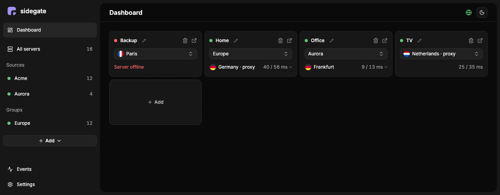

# sidegate

sidegate runs [Xray](https://github.com/XTLS/Xray-core) on a UniFi Cloud Gateway Ultra and exposes your proxy servers to UniFi as WireGuard VPN Clients, so traffic routing stays in UniFi's Policy Table. Point a VPN Client at a subscription or server group and sidegate automatically fails over when the active server goes down.

> **Beta (`0.x`):** sidegate is early beta software, tested on UniFi Cloud Gateway Ultra (UniFi OS 6.0.4, Network 11.0.99). Expect breaking changes before `1.0`.



## Install

Installation adds two systemd services and mounts the web UI behind UniFi's login. [What gets installed](docs/install.md#what-it-changes-on-the-gateway) · [Uninstall](docs/operate.md#uninstall)

SSH into your gateway as `root` and run:

```sh
curl --proto '=https' --tlsv1.2 -fsSL https://github.com/MeafQ/sidegate/releases/latest/download/install.sh | sh
```

Open `https://<gateway-ip>/sidegate/`, paste a UniFi Network API key in **Settings**, and follow [First steps](docs/install.md#first-steps) to route your first device.

When a newer version is released, an **Update** button appears under **Settings → About**.

## Limitations

- **IPv4 only.** Routed devices' IPv6 traffic may still exit via WAN.
- **8 VPN Client cap.** sidegate won't create a new VPN Client if UniFi already has 8 configured (including disabled ones).
- **No separate permissions.** Anyone allowed through UniFi's login has full access to sidegate, including installing updates.

## Documentation

- [Install & first steps](docs/install.md)
- [Operate, update & uninstall](docs/operate.md)
- [Build from source](docs/build.md)
- [Release process](docs/release.md)
- [Architecture](docs/architecture.md) · [HTTP API](web/API.md)

## License

[MIT](LICENSE). Release bundles ship Xray under [MPL-2.0](deploy/XRAY-LICENSE).
