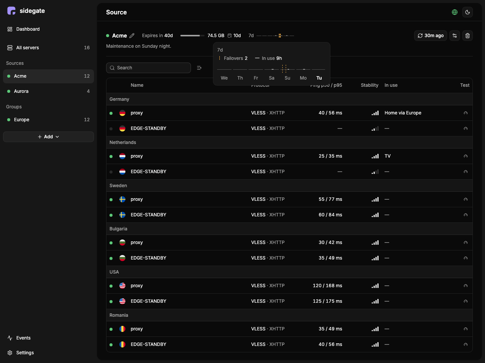
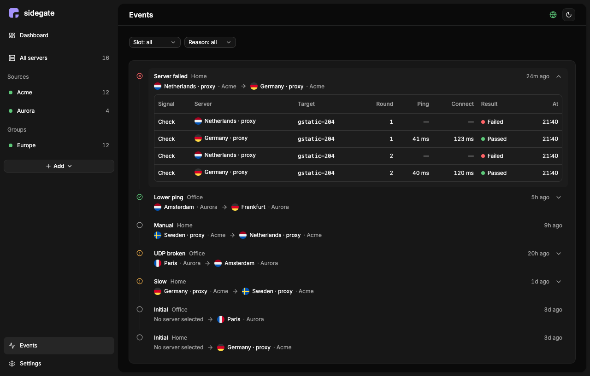

# Install sidegate

Run the [install command](../README.md#install) over SSH as `root` on your gateway. If installation stops early, it prints the reason and is safe to re-run. For updates, recovery, and removal, see [operate.md](operate.md). To install a local tarball manually, see [build.md](build.md#manual-installation).

## What it changes on the gateway

- `/data/sidegate` stores releases, Xray, configuration, analytics, and your UniFi API key. Runtime state lives under `/run/sidegate` and `/run/sidegate-http`.
- Two systemd units: `sidegated.service` (enabled at boot) and `sidegate-core.service` (Xray, started on demand by the daemon).
- One nginx drop-in: `/data/unifi-core/config/http/shared-runnable-sidegate.conf`, which mounts `/sidegate/` behind UniFi's login and reloads nginx. If the UniFi web UI ever fails to load, see [Removing the nginx hook](operate.md#remove-the-nginx-hook).
- UniFi VPN Clients: sidegate only creates, updates, and deletes the VPN Clients it owns. It reads Policy Table routes to prevent deleting active clients and never modifies routes.

Each slot (1–8) maps to one VPN Client using WireGuard interface `pxaN`, tunnel subnet `10.70.N.0/30`, UDP port `5183N`, and loopback port `1234N`. All slots share loopback ports `10085`–`10086`, `ip rule` preferences `99`–`100`, routing table `100`, and iptables chains prefixed with `sidegate-`. Make sure no other custom software on your gateway uses these.

## Verify the installation

```sh
/data/sidegate/current/sidegated status
curl -sk -o /dev/null -w '%{http_code}\n' https://127.0.0.1/sidegate/api/state
```

`status` should report `sidegated.service: enabled, active` and `nginx hook: present`. The `curl` check should return `401` when unauthenticated.

## First steps

1. **Connect UniFi:** Create a UniFi Network API key in UniFi (**Settings → Control Plane → Integrations**), then paste it into sidegate's **Settings** and click **Save**.
2. **Add a source:** In the sidebar, click **Add → Source** and paste an HTTPS subscription URL or server list (share links, Xray, sing-box, Clash, or SIP008).
3. **Create a VPN Client:** On the **Dashboard**, click **Add**, give the slot a name, choose an Exit (such as your source or a group), and click **Create**. sidegate creates a matching VPN Client in UniFi.
4. **Route a device:** In UniFi Network's **Policy Table**, route a test device through that VPN Client.
5. **Confirm:** Check the device's public IPv4 address to confirm traffic exits through your proxy.



An Exit can be a source, a custom server group (**Add → Group**), a single server, **Direct**, or **Block**. Single-server exits never fail over. **Events** logs the last 200 switches and their probe checks.


